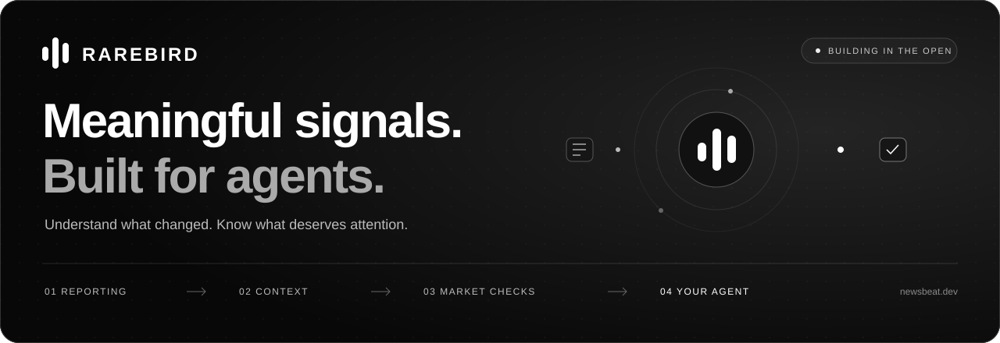

<p align="center">
  <a href="https://www.newsbeat.dev">
    
  </a>
</p>

<p align="center">
  <strong>Give your AI agent a clearer view of stocks and crypto.</strong><br>
  What changed. Why it could matter. What to check next.
</p>

<p align="center">
  <a href="https://github.com/thepeternemec/NewsBeat/actions/workflows/ci.yml"></a>
  <a href="LICENSE"></a>
</p>

<p align="center">
  <a href="https://www.newsbeat.dev"><strong>Try NewsBeat</strong></a> ·
  <a href="https://www.newsbeat.dev/intelligence">Explore a signal</a> ·
  <a href="https://www.newsbeat.dev/docs/quickstart">Connect your agent</a> ·
  <a href="https://www.newsbeat.dev/docs">Docs</a> ·
  <a href="https://www.newsbeat.dev/status">Service status</a>
</p>

---

NewsBeat is an open-source intelligence layer for AI agents. It brings together stock and crypto reporting, the context behind a development, and market checks that help an agent decide whether to investigate, keep watching or reassess.

**Built in the open since September 2026.** The news foundation is live. Signal construction and market timing are an evolving six-asset research pilot. Contributions, questions and real-world feedback are welcome.

[Get started](#get-started) · [How it works](#how-it-works) · [Project status](#project-status) · [Run locally](#run-locally) · [Contribute](#contribute)

## Why NewsBeat?

A headline tells your agent something happened. A useful signal helps it understand what deserves attention.

- **See what actually changed.** Discover recent reporting, group repeated coverage and follow new arrivals.
- **Understand the context.** Read a source-linked interpretation, its uncertainty and the questions it raises.
- **Know what to check next.** Inspect market confirmation, conditions that would change the view and explicit reasons to wait.

Use it inside a research assistant, a personal briefing or a watchlist workflow. Start with the underlying company or cryptocurrency when researching a tokenized asset.

## Get started

### 1. Explore in your browser

Search a company name or ticker on [newsbeat.dev](https://www.newsbeat.dev/#company-news). Open the [intelligence page](https://www.newsbeat.dev/intelligence) to see a reported change alongside the context your agent can use.

**No setup, account or API key required for public reads.**

### 2. Connect your AI agent

Add this URL as a remote MCP server in an assistant that supports **Streamable HTTP**:

```text
https://www.newsbeat.dev/api/mcp
```

<details>
<summary>JSON configuration for compatible MCP clients</summary>

```json
{
  "mcpServers": {
    "newsbeat": {
      "url": "https://www.newsbeat.dev/api/mcp"
    }
  }
}
```

Configuration varies by client. Follow the [connection guide](https://www.newsbeat.dev/docs/quickstart) or run the [connection check](https://www.newsbeat.dev/connect). Your assistant needs custom remote MCP support.

</details>

Then ask:

> Use NewsBeat to check NVIDIA. What changed, why could it matter, and what still needs confirmation?

### 3. Make an API request

Find an asset:

```bash
curl "https://www.newsbeat.dev/api/v2/topics?q=nvidia&limit=5"
```

Ask an evidence-led question:

```bash
curl -X POST "https://www.newsbeat.dev/api/v2/research" \\
  -H "Content-Type: application/json" \\
  -d '{"question":"What could change the outlook for NVIDIA?"}'
```

Use the returned `beat_id` for other assets. The intelligence pilot currently covers **NVIDIA, Apple, Microsoft, Alphabet, Bitcoin and Ethereum**. Question research works across the catalog; missing market measurements are explicit. [Research flow and limits](docs/RESEARCH.md).

[More examples](examples/README.md) · [API and MCP reference](AGENTS.md) · [Live tool schemas](https://www.newsbeat.dev/api/v2/tools)

## How it works

**Your question → Relevant evidence → Market checks → Answer → Next check**

NewsBeat collects source-linked headlines, reduces repeated coverage and tracks new information. The pilot builds a conditional interpretation, checks observed market activity and stores the result for agents to read.

| Your agent receives | What it helps answer |
| --- | --- |
| The reported change, source and time | What happened? |
| A contextual interpretation | Why could this matter? |
| Market confirmation and reasons to wait | Is there enough evidence to review it now? |
| Invalidation and a next check | What would change the view? |

A signal can say **review**, **keep watching**, **no alert** or **reassess**. Waiting is a useful result when evidence is missing, old or unconfirmed. Repeated headlines alone do not justify a new review alert.

<details>
<summary>Evidence, market data and research limits</summary>

- Reporting comes from English-language Google News RSS metadata. Full article bodies remain with publishers; interpretations are based on headlines.
- The stock pilot observes Kraken xStock markets against QQQx. Bitcoin and Ethereum use crypto venue data and peer comparisons. These are venue observations, not consolidated stock prices or verified token redemption values.
- Timing checks include relative market moves, participation, liquidity and data freshness. Thresholds are research heuristics awaiting calibration.
- Prospective outcome records help evaluate constructions and review alerts over time. They do not establish profitable performance or executable returns.
- NewsBeat records qualifying review alerts. Notification delivery and trade execution are not connected.

See the [methodology](docs/QUANTITATIVE.md) for the measurements, thresholds and limitations.

</details>

NewsBeat also scans the market independently of reporting: it looks for unusual relative moves, compares them with earlier behavior and records what happened next. The same existing venue data powers this discovery layer; a headline is not required to start an investigation. [How discovery works](docs/QUANTITATIVE.md#independent-discovery-market-discovery-v1)

## Project status

**Early development · active research pilot · MIT licensed**

| Stage | Available today |
| --- | --- |
| News foundation | A bundled catalog of 2,030 stock and crypto topics; headlines, grouping, freshness and change tracking |
| Question research | Direct answers, cited reasoning, unknowns and next checks across the catalog; available market checks included |
| Agent access | Public MCP and REST interfaces; asset discovery and batched watchlist reads |
| Intelligence pilot | Six assets, three contexts, persistent interpretations, market checks and a review-alert journal |
| Independent discovery | 15/30/60-minute anomaly scans, past-only comparisons, volatility context and an episode journal |
| Evaluation | Prospective observations for comparing all constructions with selected review alerts |

**Next:** calibrate against collected outcomes, add richer evidence and expectation changes, and expand measured coverage. Saved watches, notification delivery and verified tokenized-asset mapping are planned.

The catalog is scheduled every 10 minutes. One-minute news collection for a priority asset starts only on explicit request, lasts 15 minutes and never auto-renews. Analysis and market measurements remain on five-minute schedules. Read freshness and analysis timestamps: schedules do not guarantee fresh results for every asset.

[Current capabilities](docs/STATUS.md) · [Product direction](docs/INTELLIGENCE.md) · [Changelog](CHANGELOG.md)

## Run locally

Use **Node.js 22 or 24** and npm.

```bash
git clone https://github.com/thepeternemec/NewsBeat.git
cd NewsBeat
npm ci
npm run build
npm test
npm run dev
```

Open **http://localhost:3000**. You can build, run the standard tests and work on the interface without service credentials. Local news reads need a development PostgreSQL database and cursor secret.

Follow the [development guide](docs/DEVELOPMENT.md) to configure local data, run ingestion and test the API. Hosted public reads are the fastest way to try NewsBeat.

<details>
<summary>Repository map</summary>

| Path | Purpose |
| --- | --- |
| `apps/web` | Next.js website, API mount and scheduled routes |
| `apps/api` | Hono REST API, MCP transport and intelligence pipeline |
| `apps/worker` | Collection, filtering and normalization |
| `packages/contracts` | Shared schemas, asset catalog and tool definitions |
| `packages/db` | PostgreSQL access, accounts and metering |
| `db` | Schema and maintenance scripts |
| `examples` | API recipes and a reference model adapter |
| `docs` | Development, methodology and operations |

[Architecture](docs/ARCHITECTURE.md) · [Documentation index](docs/README.md)

</details>

## Optional one-minute collection

On the intelligence page, choose **Request 1-min news · 15 min** for the selected priority asset. Or explicitly ask your agent for one-minute collection; `newsbeat_collection` starts the bounded session only with `action: "start"` and `interval_seconds: 60`. Status reads and ordinary news lookups do not activate it. You can stop your own session early. [Request and API details](docs/COLLECTION.md)

## Access

Public MCP and REST reads are free during early access, with an anonymous limit of **120 requests per minute**. An API key is optional.

Optional account keys offer a seven-day REST evaluation, starting on the first metered request, with up to $6 in credit and a higher rate limit. Paid checkout is not live. [Access details](https://www.newsbeat.dev/docs)

## Contribute

NewsBeat is young, and there is room to help shape it. Good places to start:

- Improve a setup step, example or explanation.
- Report a confusing signal or asset match, including the source and time.
- Improve accessibility, source grounding or market-data checks.
- Help evaluate outcomes or extend measured coverage.

Read [CONTRIBUTING.md](CONTRIBUTING.md), [open an issue](https://github.com/thepeternemec/NewsBeat/issues/new/choose), or [start a discussion](https://github.com/thepeternemec/NewsBeat/discussions). Small, focused pull requests are welcome.

[MIT license](LICENSE) · [Code of conduct](CODE_OF_CONDUCT.md) · [Security](SECURITY.md)

<p align="center">
  Built by <a href="https://github.com/thepeternemec">Peter Nemec</a> and contributors.<br>
  <a href="https://www.newsbeat.dev">newsbeat.dev</a> · <a href="https://x.com/newsbeat_">@newsbeat_</a> · <a href="mailto:contact@newsbeat.dev">contact@newsbeat.dev</a>
</p>
