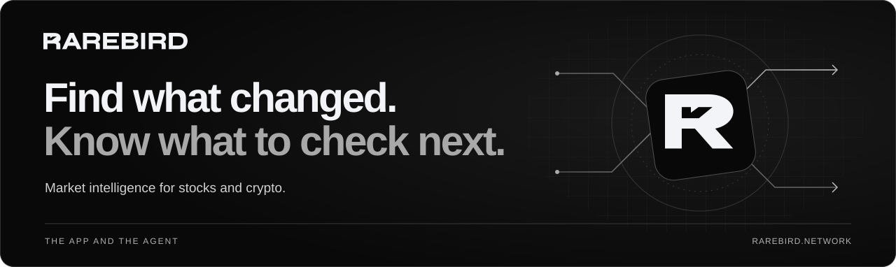

<p align="center">
  <a href="https://www.rarebird.network/">
    
  </a>
</p>

# Market intelligence for stocks and crypto

Rarebird brings market developments, source evidence and risk context into one workspace and one connected AI agent. See what changed, why it could matter, and what would change your view.

**[Open the app ↗](https://www.rarebird.network/app)** &nbsp;·&nbsp; **[Connect your agent ↗](https://www.rarebird.network/for-agents)**

**Free through December 31, 2026.** Both are included in the planned Rarebird Pro membership at **$8.99 USD/month**. [See pricing](https://www.rarebird.network/pricing).

## What you can do today

| | What Rarebird gives you |
| --- | --- |
| **Find what moved** | Follow market developments across 2,030 stock and crypto topics. Open the original source and see when it was published and recorded. [Market checks](https://www.rarebird.network/intelligence#discovery) |
| **Investigate the risk** | Look up a ticker and get a brief with supporting evidence, downside risks and what to check next. A six-asset pilot measures unusual moves, volume and liquidity. [Ticker research](https://www.rarebird.network/ask) |
| **Check the track record** | Inspect experimental hourly BTC and ETH forecasts and compare their outcomes with a historical baseline. [Forecast scorecard](https://www.rarebird.network/app/forecasts) |

**In development:** portfolio-aware risk monitoring and position sizing using your loss budget, liquidity and existing exposure. Today’s research shows the timestamps, uncertainties and coverage behind each result.

## Use the app or connect an agent

**In the app:** [Open the workspace](https://www.rarebird.network/app). Switch between stocks and crypto, research a ticker, or explore crypto prices and your watchlist.

**In your assistant:** Add Rarebird as a remote MCP server using Streamable HTTP. A compatible client can discover tools such as `rarebird_discovery` and `rarebird_research`.

```text
https://www.rarebird.network/api/mcp
```

Try asking: *What changed with NVIDIA? Which sources support it, and what should I watch next?*

**With REST:** Look up an asset or ask a research question directly.

```bash
curl 'https://www.rarebird.network/api/v2/topics?q=nvidia&limit=5'

curl -X POST 'https://www.rarebird.network/api/v2/research' \
  -H 'Content-Type: application/json' \
  -d '{"question":"What could change the outlook for NVIDIA?"}'
```

[Connection guide](https://www.rarebird.network/docs/quickstart) · [API and MCP reference](AGENTS.md) · [Examples](examples/README.md) · [Service status](https://www.rarebird.network/status)

## Read the evidence

Rarebird records when it first sees a development and links the reporting behind it. Where market measurements exist, it checks for confirmation and flags stale or missing inputs. A review can identify reasons to wait or specify what would invalidate a view.

Catalog news collection runs on a ten-minute schedule. Priority assets support fifteen-minute sessions of one-minute news collection on request. Market checks and forecasts use separate schedules and report their own freshness.

[Research coverage](docs/RESEARCH.md) · [Market and forecast methodology](docs/QUANTITATIVE.md) · [Current capabilities](docs/STATUS.md)

## Built in the open

| What shipped | Implementation |
| --- | --- |
| Source-linked ticker research and Telegram briefs | [#121](https://github.com/thepeternemec/rarebird/pull/121) |
| Catalog-wide market discovery with source and observation times | [#131](https://github.com/thepeternemec/rarebird/pull/131) |
| Token identity and pool evidence by chain and contract | [#125](https://github.com/thepeternemec/rarebird/pull/125) |
| Hourly BTC and ETH forecasts and forward evaluation | [#130](https://github.com/thepeternemec/rarebird/pull/130) |
| Direct filing evidence for four pilot issuers | [#119](https://github.com/thepeternemec/rarebird/pull/119) |

[Changelog](CHANGELOG.md) · [Commit history](https://github.com/thepeternemec/rarebird/commits/main/) · [Build checks](https://github.com/thepeternemec/rarebird/actions)

## Develop locally

Use Node.js 22 or 24 with npm.

```bash
git clone https://github.com/thepeternemec/rarebird.git
cd rarebird
npm ci
npm run build
npm test
npm run dev
```

Open <http://localhost:3000>. You can build the interface and run most tests without credentials. For ingestion and persistence, see the [development guide](docs/DEVELOPMENT.md).

[Architecture](docs/ARCHITECTURE.md) · [Contribute](CONTRIBUTING.md) · [Security](SECURITY.md) · [MIT license](LICENSE) · [Brand assets](brand/README.md)
