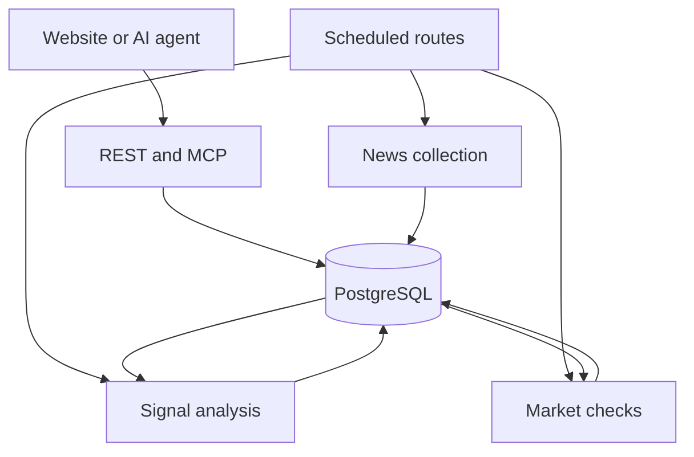

# NewsBeat architecture

[Documentation](README.md) · [Development](DEVELOPMENT.md) · [Methodology](QUANTITATIVE.md)

NewsBeat runs its website, REST API and MCP endpoint in one Next.js deployment. PostgreSQL stores the reporting, analysis state, signal revisions and evaluation records. Scheduled routes perform collection and analysis; public intelligence reads use stored results.

## Components

| Component | Responsibility |
| --- | --- |
| `apps/web` | Next.js interface, Hono API mount and scheduled route handlers |
| `apps/api` | REST and MCP interfaces, source-grounded analysis, construction and timing logic |
| `apps/worker` | Provider requests, headline matching, normalization and ingestion |
| `packages/contracts` | Shared Zod schemas, the asset catalog and tool definitions |
| `packages/db` | Database access, account keys, rate limits and metering |
| `db/schema.sql` | Idempotent schema for news, analysis, market observations, alerts and evaluation |

## Read and update paths

The Hono app is mounted at `/api/*` by the Next.js catch-all route. REST uses `/api/v2/*`; MCP uses `/api/mcp`. An intelligence read does not invoke the analysis model.

## News foundation

The default collector queries Google News RSS, matches supported asset names in headlines, normalizes records and persists source links and publication times. Duplicate URLs are not inserted twice for the same asset.

News reads use signed, asset-bound cursors. Clients save the returned cursor and ask for later arrivals through the changes endpoint. An empty result is a successful check.

Stories and summaries operate on bounded snapshots. Grouping is approximate; summaries and interpretations use headline metadata rather than full article text.

## Intelligence and market checks

The six-asset pilot keeps source-grounded interpretations and revisions in PostgreSQL. The model proposes a conditional explanation; deterministic validation checks the shape and supplied source evidence before it is stored.

The market worker collects Kraken xStock and crypto observations. Timing logic considers information delta, relative market movement, participation, liquidity and freshness. Qualifying review alerts are recorded with stable identities. Prospective observations support later evaluation.

A model interpretation and an observed price move do not establish causality. Missing or unconfirmed evidence can hold a review alert. Read the [quantitative methodology](QUANTITATIVE.md) for the exact research policy.

## Runtime configuration

- The interface and ordinary API reads share the Next.js process.
- PostgreSQL and the cursor secret are required for local news data.
- Model generation needs server-side AI Gateway authentication.
- Pilot scheduled routes require their configured bearer secret.
- Optional GitHub OAuth enables account-key issuance.

See [DEVELOPMENT.md](DEVELOPMENT.md) for exact environment-file locations and runnable commands. [vercel.json](../apps/web/vercel.json) defines the deployed schedules.

## Verification

The standard suite checks contracts and pure application behavior without service credentials. CI separately verifies persistence against disposable PostgreSQL. Main-branch CI checks the deployed read path, measured context, analysis health and authenticated worker boundaries.

The workflow is defined in [ci.yml](../.github/workflows/ci.yml).
